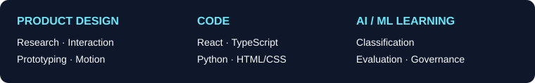

# Hey, I'm Seedorf 👋

### Product designer bringing ideas to life through design and code.

I'm a Computer Science and Psychology student at Grambling State University, pursuing product design opportunities. My background in visual and motion design shapes how I approach interaction design, prototyping, and interfaces that are easy to understand. I use code to explore how my designs work in practice.

[Portfolio](https://seedorfotchere.com/) · [LinkedIn](https://www.linkedin.com/in/seedorfotchere) · [Email](mailto:seedorfotchere1000@gmail.com)

## Selected projects

| Project | Focus and my involvement |
| --- | --- |
| **[Cyera — AI Tool Discovery & Risk Classification](https://github.com/Break-Through-Tech/Cyera-1A-ai-tool-discovery-and-risk-classification)** | **Fall AI Studio team project.** Discovering AI functionality and explaining contextual governance risk. My focus is design and frontend; interface work is in progress. Research and model results are team outputs. |
| **[Census Income Classification](https://github.com/seeedorfff/census-income-classification)** | Individual Break Through Tech ML capstone comparing logistic regression and a neural network. Includes data exploration, model evaluation, and discussion of methodological limitations. |
| **[Portfolio](https://seedorfotchere.com/)** · [Repository](https://github.com/seeedorfff/portfolio) | A place to explore my design work, supported by a web portfolio repository. |

## Break Through Tech AI

Through Break Through Tech AI, I'm developing my understanding of data preparation, classification, and model evaluation. My individual Census Income Classification capstone explores how modeling choices affect results. In Fall AI Studio, I work with the Cyera team on AI Tool Discovery & Risk Classification, focusing on design and frontend.

I bring this experience into product design by considering how interfaces communicate evidence, uncertainty, and the limits of AI-generated results.

## My toolkit

**Design** · Research, prototyping, interaction, design systems, motion  
**Code** · Python, JavaScript, TypeScript, React, Node.js, HTML/CSS, Tailwind CSS  
**Tools** · Figma, Framer, Adobe Creative Suite, Blender, Rive, Spline, Unreal Engine

## Beyond the screen

Motion design, mentoring designers, and collecting little wonders.

## Contact

Email: [seedorfotchere1000@gmail.com](mailto:seedorfotchere1000@gmail.com)  
[LinkedIn](https://www.linkedin.com/in/seedorfotchere) · [Portfolio](https://seedorfotchere.com/)
